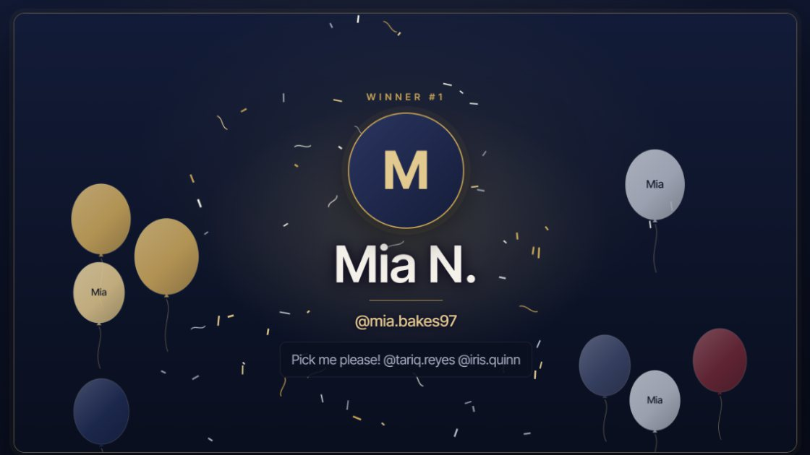
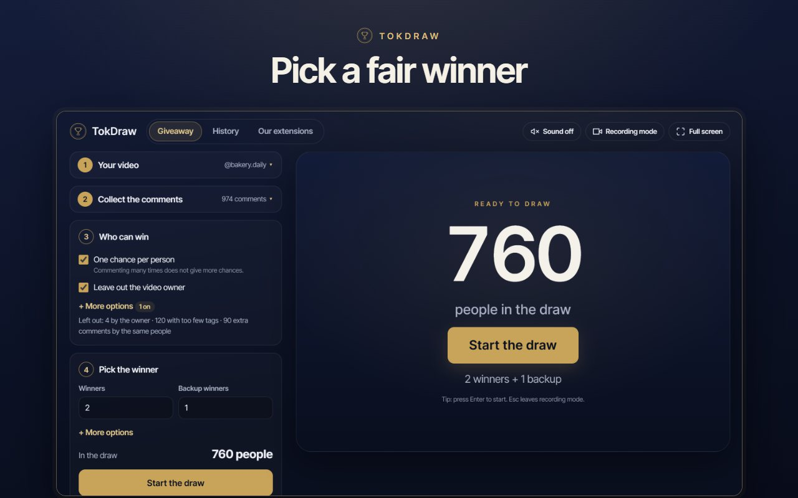
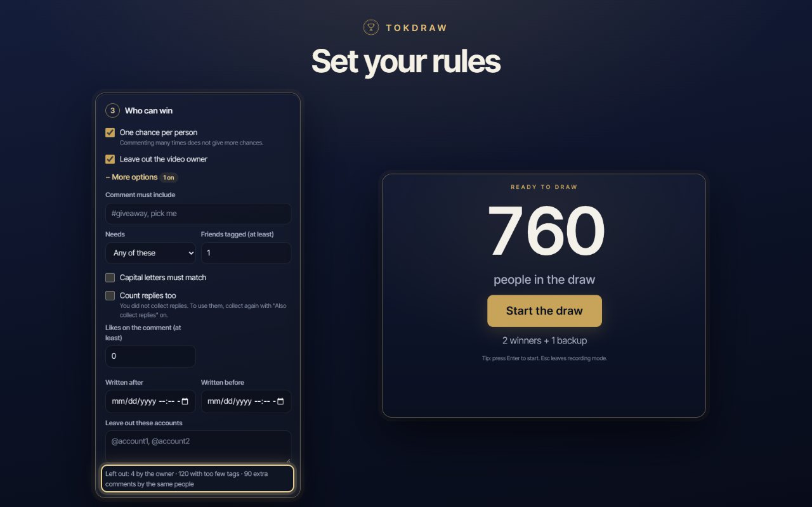
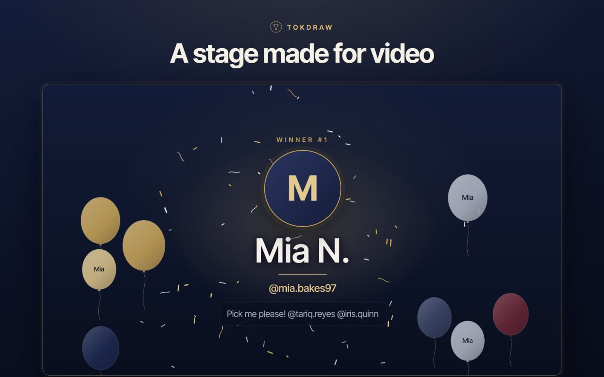
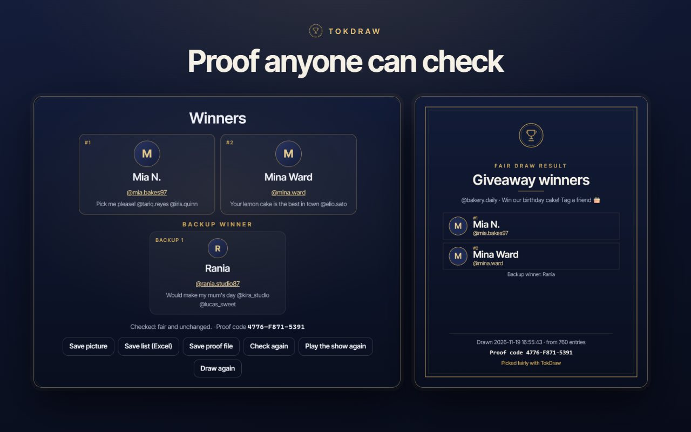
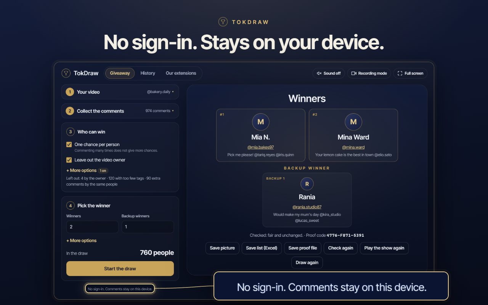

# TokDraw - TikTok Giveaway Picker & Comment Picker

TokDraw is a Chrome extension that picks a giveaway winner from the comments on a TikTok video. It collects the comments, applies your rules, draws the winner and your backups on a stage made for screen recording, and gives every draw a proof code anyone can check. No sign-in, and nothing is uploaded.

<a href="https://chromewebstore.google.com/detail/naadeafghmmliigjfnagfhidgoaombdi?utm_source=github&utm_medium=readme&utm_campaign=tokdraw">Chrome Web Store</a> |
<a href="https://www.addonschrome.com/extensions/tokdraw-tiktok-giveaway-picker-comment-picker.html?utm_source=github&utm_medium=readme&utm_campaign=tokdraw">Full guide and FAQ</a> |
<a href="https://www.youtube.com/watch?v=nQ56ua-aSC4">Video demo</a>

This repository is the public home for TokDraw's documentation, release notes and issue tracker. The extension itself is distributed through the Chrome Web Store.

## Features

- **Any TikTok video:** paste the link of a single video, or choose a video you already have open in a tab. TokDraw reads the comments TikTok makes available for it.
- **Rules for a fair giveaway:** one chance per person (on by default), a required word or hashtag, a minimum number of tagged friends or likes, a date range, replies counted or not, the video owner and any accounts you name left out. You see how many people are in the draw and how many comments each rule left out.
- **Winners and backups:** choose one winner or several, and set how many backups you want.
- **Proof anyone can check:** every draw gets a proof code. "Check again" re-runs the draw from the saved record and confirms the result is unchanged. You can save a proof file so others can check it too.
- **A stage made for recording:** recording mode hides the controls. Elegant or Party style, quick, normal or big show. Sound starts off, and reduced motion is respected.
- **Results to keep:** a picture of the winners, a spreadsheet of the winners, or the proof file. Every giveaway stays in History on your device.
- **A safe pace:** comments are collected slowly on purpose so TikTok does not block your browser. You see a time estimate first and can choose a pace.
- 50+ interface languages.

## How to use it

1. Click the TokDraw icon in the Chrome toolbar (pin it from the puzzle-piece menu if needed).
2. Paste the link of your video, or pick a video that is open in a tab.
3. Let TokDraw collect the comments. A counter shows the progress; big videos take a little longer.
4. Set who can win, then start the draw. A countdown reveals the winner and the backups. Save the picture or the proof file, or press "Check again".

Note: TikTok does not always hand over every comment (some are hidden or filtered). TokDraw shows both numbers, the one TikTok reports and the one it could collect.

## Privacy

- No account, no sign-in, never asks for your TikTok password.
- No TokDraw server, no analytics, no tracking. Comments, rules and past giveaways stay in your browser.
- It only reads the comments of the video you choose. It never posts, replies, likes or follows.

Please follow TikTok's rules for promotions and the giveaway laws where you and your participants live.

## Screenshots

## Support

Found a bug or have a feature request? [Open an issue](../../issues).

## Disclaimer

TokDraw is an independent extension. It is not affiliated with, endorsed by, or connected to TikTok Pte. Ltd. or ByteDance Ltd. TikTok is a trademark of its owner and is used here only to describe what the extension works with.

---

Built and maintained by [Addons Chrome](https://www.addonschrome.com/?utm_source=github&utm_medium=readme&utm_campaign=tokdraw).
